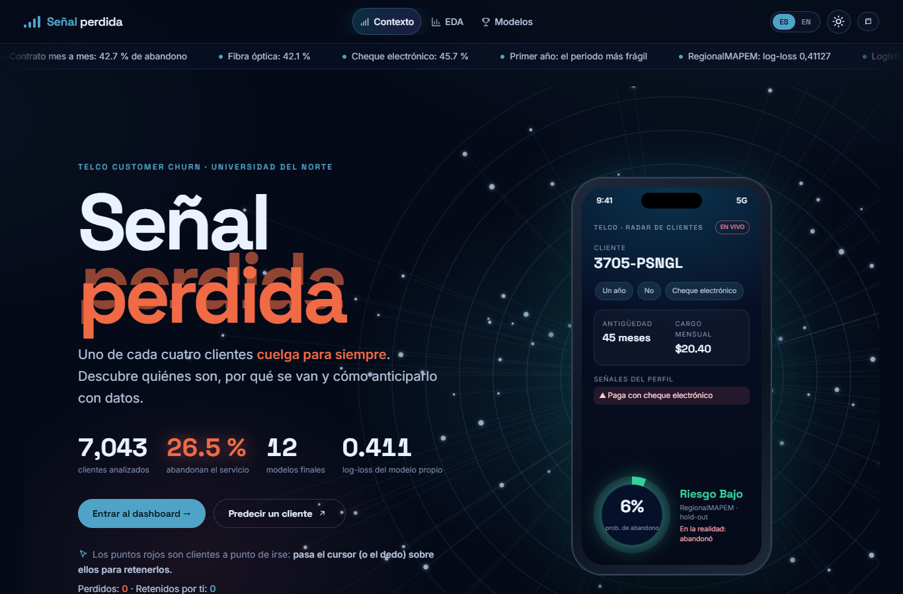

# Señal perdida · Dashboard Telco Customer Churn

Dashboard predictivo construido con **Dash y Plotly** para el proyecto de abandono de clientes de **Laura S. Rivera
Figueredo y Natalý A. Cárdenas Izaquita** (Universidad del Norte). Explica el problema, deja explorar los datos y usa los
12 modelos finales del entregable 4 (11 benchmarks calibrados y el modelo propio, RegionalMAPEM) para predecir en vivo.



- URL pública: _pendiente de crear el servicio en Render_
- Jupyter Book: https://nataly-cardenas.github.io/Telco_Churn_Entregable/ (capítulo 8: dashboard y despliegue)
- Experimento y resultados: https://github.com/Nataly-Cardenas/Telco_Churn_Entregable

## Secciones

La aplicación es multipágina (`use_pages=True`), con una página por sección:

| Ruta | Página | Contenido |
|---|---|---|
| `/` | Contexto | Portada interactiva, problema con cifra citada, pregunta de investigación, objetivos, ficha y diccionario de los datos, diagrama de la metodología, marco teórico, limitaciones, ética, autoras y versión |
| `/eda` | EDA | Filtros globales (partición, contrato, internet, antigüedad), variable objetivo, univariado, bivariado con pruebas y Holm, explorador bivariado (ejes y color a elección), correlaciones, faltantes y atípicos, preparación de datos y descarga CSV |
| `/modelos` | Modelos | Tabla de líderes ordenable y filtrable, predicción en vivo con probabilidad, conjunto conforme al 90 % y SHAP local, diagnóstico (confusión, calibración, ROC, precisión-recall), SHAP global, diagrama de diferencia crítica y 223 contrastes con Holm, modelo original (pseudocódigo, convergencia, pruebas, robustez y veredicto), ficha del modelo y resultados del entregable 2 |

## Estructura

```
app.py                  punto de entrada: crea la app, la barra fija, idioma y tema; expone server
pages/                  contexto.py, eda.py, modelos.py (layout y callbacks de cada página)
src/
  data.py               carga única de datos y resultados (lru_cache)
  modelos.py            carga de artefactos, validación de entradas, predicción y SHAP local
  pipeline_telco.py     preprocesamiento y benchmarks del experimento (para cargar los artefactos)
  original_model.py     clase RegionalMAPEM (copia del repositorio del experimento)
  plots.py              paleta, plantilla y funciones de las figuras
  ui.py                 tarjetas, tablas, pestañas y avisos
  eda.py, entregable2.py, chatbot.py, i18n.py, icons.py
artifacts/<modelo>/     modelo.joblib (compress=3) y metadata.json de cada uno de los 12 modelos
data/                   datos originales, resultados copiados del experimento, MODEL_CARD.md y DATA_STATEMENT.md
scripts/                construir_artefactos.py y preparar_resultados.py (se corren fuera del servidor)
tests/                  pruebas del tablero, de los artefactos (ida y vuelta) y del modelo original
.github/workflows/      pytest en cada push
```

## Artefactos

`scripts/construir_artefactos.py` reentrena los 12 pipelines finales sobre los 5634 clientes de desarrollo con los
hiperparámetros que eligió la búsqueda del protocolo (TPE, 30 evaluaciones sobre 3 pliegues internos) en la corrida final,
y verifica que sus probabilidades sobre el hold-out coinciden exactamente con las guardadas por el experimento. Cada
`metadata.json` registra versiones, semilla, hiperparámetros, esquema de entrada (tipos, categorías y rangos), métricas de
la validación anidada y del hold-out, umbral F1, tamaño y SHA-256. Los 12 artefactos ocupan 6 MB.

El dashboard **nunca entrena**: solo carga los artefactos una vez por proceso. Para regenerarlos:

```bash
python scripts/construir_artefactos.py ../Telco_Churn_Entregable
python scripts/preparar_resultados.py ../Telco_Churn_Entregable
```

## Ejecutar localmente

Requiere Python 3.12 (las versiones de `requirements.txt` son las del entorno con el que se entrenaron los artefactos).

```bash
python -m venv .venv
.venv\Scripts\activate          # Windows; en Linux o macOS: source .venv/bin/activate
pip install -r requirements.txt
python app.py
```

Abrir http://localhost:8050. La variable `PORT` cambia el puerto.

## Pruebas

```bash
pip install -r requirements-dev.txt
python -m pytest -q
```

Incluyen la prueba de ida y vuelta (serializar y volver a cargar cada artefacto da exactamente las mismas predicciones que el
modelo en memoria sobre 40 clientes fijos), la metadata, la validación de entradas, SHAP, las 12 pruebas del modelo original, las
tres páginas y sus callbacks, las traducciones y la paleta. GitHub Actions las corre en cada push.

## Despliegue en Render

1. En Render, **New → Blueprint** y elegir este repositorio: `render.yaml` crea el servicio web.
2. Render ejecuta `pip install -r requirements.txt` y arranca con
   `gunicorn app:server --bind 0.0.0.0:$PORT --workers 1 --threads 4 --timeout 180`.
3. `PYTHON_VERSION` queda fijada en 3.12.14 y `/healthz` sirve como verificación de salud.
4. Revisar los logs de construcción y abrir las tres páginas en la URL pública.

Un solo proceso basta: con los 12 modelos y SHAP cargados la app ocupa unos 280 MB, dentro de los 512 MB del plan
gratuito. El servicio gratuito se suspende tras un rato sin visitas; conviene abrir la URL unos minutos antes de la
sustentación. La variable `ANTHROPIC_API_KEY` es opcional (asistente con Claude); sin ella el asistente usa su base local.

## Idioma, tema y paleta

Botones `ES | EN` y modo claro u oscuro arriba a la derecha. Las gráficas usan `#2E86AB` para todas las series,
`#E4572E` para resaltar y `#9AA5B1` para referencias; una prueba verifica que no aparezcan otros colores.
