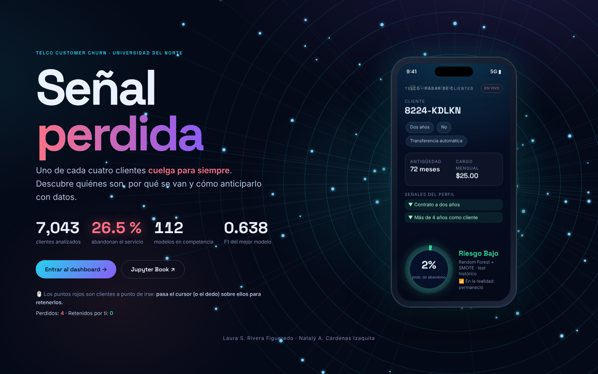

# Señal perdida · Dashboard Telco Customer Churn

Dashboard interactivo en español, construido con **Python Dash y Plotly**, para explorar el proyecto de abandono de clientes de **Laura Rivera y Natalý Cárdenas**, Universidad del Norte.



- Jupyter Book: https://nataly-cardenas.github.io/Telco_Churn_Entregable/
- Fuente de los datos y resultados: https://github.com/Nataly-Cardenas/Telco_Churn_Entregable
- Commit de los datos: `41191edb71ebf15a1543d538a158513db8781d2f` (recuperado el 23 de octubre de 2026).

## Ejecutar

Requiere Python 3.12. Desde esta carpeta:

```bash
python -m venv .venv
source .venv/bin/activate
pip install -r requirements.txt
python app.py
```

En Windows, activar con `.venv\Scripts\activate`.
Abrir http://localhost:8050. La variable `PORT` permite cambiar el puerto.

## Publicar en Render

El proyecto incluye `render.yaml` y expone `server = app.server`:

1. Subir estos archivos al repositorio de la aplicación.
2. En Render, crear un Blueprint desde ese repositorio usando `render.yaml`.
3. Render instala dependencias y ejecuta `gunicorn app:server --bind 0.0.0.0:$PORT --workers 2 --timeout 120`.

La app no requiere claves, base de datos ni acceso a GitHub al ejecutarse. No se ha creado un servicio remoto desde esta sesión.

## Recorrido

- **Portada interactiva:** una red de clientes conectados a un celular 3D. Los puntos rojos son clientes a punto de irse y se pueden retener pasando el cursor (o el dedo). El celular muestra clientes reales del test con la probabilidad de abandono del Random Forest finalista y las señales de su perfil.
- **El problema:** el reto, el objetivo general, los 8 objetivos específicos, el marco teórico en tarjetas que se voltean y un selector de variables con su tasa de abandono.
- **Datos:** filtros globales y cinco pestañas: calidad, distribuciones, segmentos de riesgo (sunburst y animación por antigüedad), relaciones y explorador con descarga CSV.
- **Preparación:** el pipeline animado, controles, modelo base y ablación.
- **Arena de modelos:** podio, ranking de las 112 configuraciones, galaxia 3D, carrera animada de buscadores, calibración y evidencia estadística.
- **Simulador:** perfil de riesgo con clientes similares, clientes reales del test con las probabilidades de los tres finalistas y laboratorio de umbral.
- **¿Por qué se van?:** factores clave, SHAP global y local, y LIME.
- **Conclusiones:** hallazgos, limitaciones, próximos pasos, enlace al paper y biblioteca con todo el texto del libro, buscable.
- **Autoras:** autoría, enlace al Jupyter Book y recursos.

Las rutas usan fragmentos (`#problema`, `#modelos`, etc.), así que admiten enlaces directos y la navegación del navegador. El diseño se adapta a móvil y respeta `prefers-reduced-motion`.

## Contrato de datos

- Dataset real de 7.043 clientes, 1.869 abandonos.
- Índices históricos: 5.634 train y 1.409 test, sin solapamiento.
- `TotalCharges` se convierte a numérico para el EDA y conserva sus 11 ausencias. La explicación del pipeline documenta su imputación determinista con cero por `tenure = 0`.
- Los filtros superiores afectan al EDA y al explorador. **No recalculan ni reentrenan modelos publicados**.
- El simulador de perfil muestra la tasa de abandono **observada** en clientes de entrenamiento parecidos; no es una predicción del modelo.
- La tabla de 112 configuraciones representa media y desviación de cinco folds externos de la realización 0. `unidades.csv` contiene las 1.680 unidades (112 × 3 × 5).
- El panel de optimización promedia el mejor F1 **interno** acumulado, sin confundirlo con el externo.
- El laboratorio de umbral usa predicciones **nativas** guardadas de tres finalistas sobre el test histórico. Es didáctico: mover el umbral no valida una regla operativa.
- El test ya había sido expuesto en la primera entrega y es evidencia suplementaria. Los contrastes por folds son exploratorios, no confirmatorios.
- No se cargan pickles ni se entrena al iniciar. La selección de archivos está en `data/provenance.json`.
- Los textos de la biblioteca y las figuras LIME proceden de los notebooks y artefactos originales, con atribución. La biblioteca omite código y salidas de ejecución; las gráficas y tablas del dashboard presentan los resultados numéricos originales.
- En el comparador, las barras de error son **desviaciones estándar**, no IC. El mapa familia × balanceo promedia optimizadores.
- La tabla del explorador filtra su vista localmente. El CSV exporta la selección completa de los filtros superiores y las columnas elegidas, tal como indica la interfaz.

## Archivos

- `app.py`: portada, secciones, callbacks y servidor.
- `analytics.py`: carga local, cohortes, tasas, clientes similares y errores por umbral.
- `assets/style.css`: diseño visual, animaciones y estilos de los controles de Dash 4.
- `assets/cover.js`: red de clientes, celular 3D y contadores animados (Dash lo carga automáticamente).
- `data/`: CSV, interpretabilidad y textos originales necesarios, unos 8 MB.
- `tests/test_dashboard.py`: integridad del split, métricas, filtros, simulador, serialización de páginas, exportación y endpoints.
- `preview-desktop.png`, `preview-mobile.png`: capturas reales del dashboard.

## Verificar

```bash
pip install pytest
python -m pytest -q
```

Se comprobaron navegación, filtros, comparación de modelos, búsqueda, descarga CSV y visualización de escritorio/móvil con Chromium. `/healthz` entrega un estado simple para monitoreo. No se han reproducido los entrenamientos originales; se verifican los artefactos publicados.
